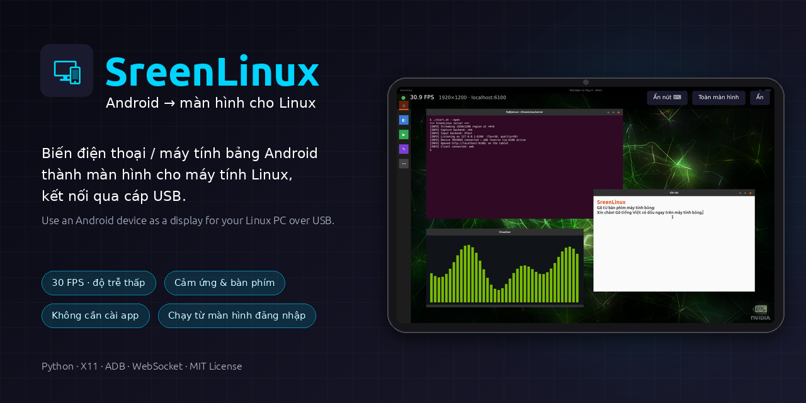
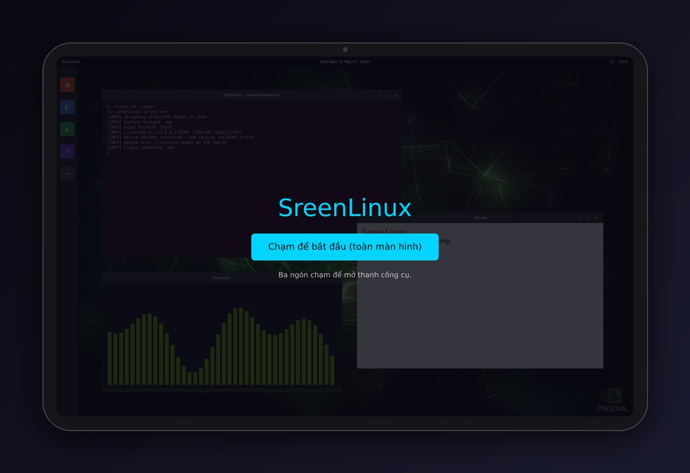
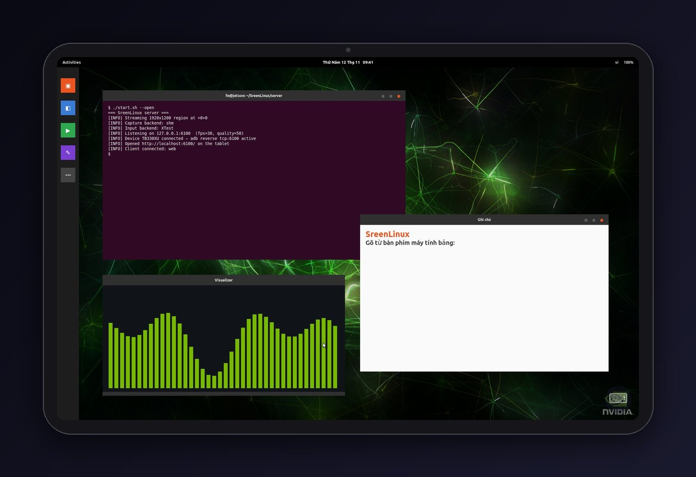
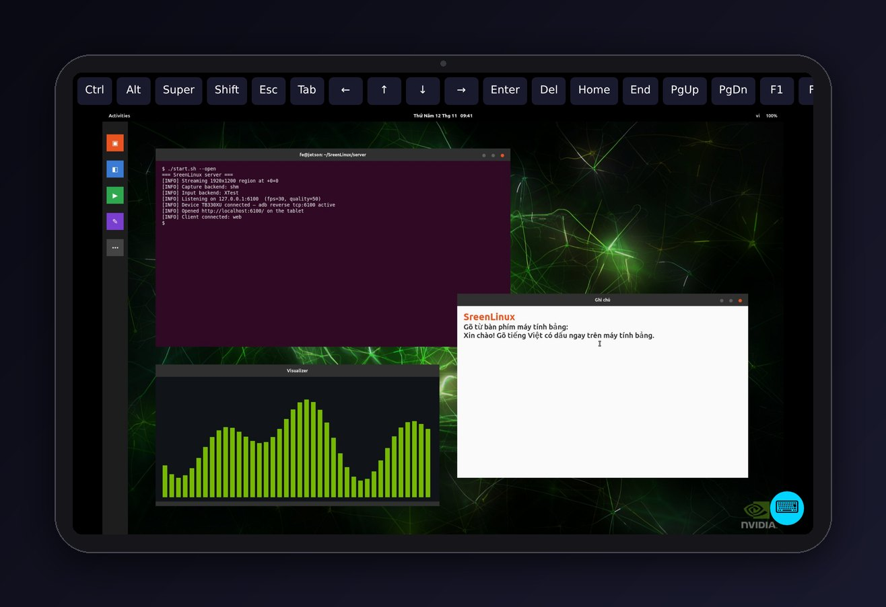

<p align="center">
  
</p>

# SreenLinux - Biến Android thành Màn hình Linux

> **Sử dụng thiết bị Android làm màn hình hiển thị mở rộng cho Linux, kết nối qua cáp USB**
>
> *Turn your Android phone or tablet into a second display for your Linux PC over a USB cable.*

[](LICENSE)
[]()
[]()
[]()

---

## 📸 Hình Ảnh (Screenshots)

Ảnh chụp thật của bản web trên máy tính bảng 1920×1200, stream từ một desktop Linux demo.

| Kết nối & bắt đầu | Desktop Linux trên máy tính bảng |
|:---:|:---:|
|  |  |
| Tự kết nối khi cắm cáp; chạm một lần để vào toàn màn hình | Hình ảnh 30 FPS, con trỏ chuột thật, cảm ứng như chuột |
| **Bàn phím ảo** | **Thanh công cụ** (chạm 3 ngón) |
|  |  |
| Gõ tiếng Việt có dấu, hàng phím Ctrl/Alt/Esc/Tab/mũi tên | FPS thực tế, độ phân giải, toàn màn hình, ẩn/hiện nút ⌨ |

---

## 🌟 Tính Năng Nổi Bật (Key Features)

- 🌐 **Không cần cài app**: Mở Chrome trên điện thoại vào `http://localhost:6100` là dùng được ngay (cùng cáp USB, cùng cử chỉ cảm ứng). App Android riêng vẫn có sẵn nếu bạn muốn.
- ⚡ **Kết nối cáp USB qua ADB**: Tận dụng đường truyền vật lý USB thông qua cơ chế ADB reverse port forwarding, đạt băng thông cao, độ ổn định tuyệt đối và độ trễ cực thấp (< 50ms) so với mạng Wi-Fi.
- 🎯 **Stream thời gian thực 30 FPS**: Chụp màn hình qua MIT-SHM (~8ms/frame 1080p), nén JPEG; bỏ qua frame không thay đổi để tiết kiệm CPU và băng thông.
- 👆 **Hỗ trợ thao tác cảm ứng (Touch Input)**: Chạm = click, giữ = click phải, kéo thả, vuốt 2 ngón = cuộn — chuyển thành sự kiện chuột X11 qua XTest (fallback `xdotool`).
- 🖱️ **Hiển thị con trỏ chuột**: Con trỏ thật của Linux được vẽ vào khung hình (XFixes), dùng chuột máy tính trên màn hình mở rộng vẫn thấy rõ.
- 🖥️ **Mở rộng màn hình ảo (Virtual Display)**: Tự động khởi tạo màn hình phụ thứ hai độc lập bằng `xrandr` (đặt bên phải, bên trái, trên, dưới màn hình chính) thay vì chỉ nhân bản (mirror).
- 🔄 **Tự động kết nối lại (Auto-Reconnect)**: Client Android tự động kết nối lại khi cáp USB bị lỏng hoặc server khởi động lại với thuật toán Exponential Backoff.
- ⌨️ **Bàn phím**: Gõ bằng bàn phím điện thoại (kể cả tiếng Việt), có hàng phím Ctrl/Alt/Esc/Tab/mũi tên — đủ để gõ mật khẩu ở màn hình đăng nhập.
- 🔐 **Chạy từ màn hình đăng nhập**: Dịch vụ hệ thống khởi động cùng máy, dùng được khi máy không có màn hình thật.
- 📱 **Chế độ toàn màn hình (Immersive Mode)**: Ẩn hoàn toàn thanh điều hướng và thanh trạng thái của Android; chạm 3 ngón tay (hoặc nút Back) để bật/tắt thanh thông tin FPS & nút ngắt kết nối.
- 🪶 **Siêu nhẹ & Tối giản**: Không cần cài đặt các ứng dụng bên thứ ba cồng kềnh; máy chủ viết bằng Python với thư viện chuẩn + Pillow.

---

## 📋 Yêu Cầu Hệ Thống (Prerequisites)

### 1. Máy tính Linux (Host)
- **Hệ điều hành**: Ubuntu 20.04 LTS / 22.04 LTS / 24.04 LTS hoặc bất kỳ bản phân phối Linux nào chạy **X11 (Xorg)**. *(Lưu ý: Wayland hiện chưa hỗ trợ chụp màn hình XShm và xrandr virtual monitor; vui lòng chuyển sang phiên bản Xorg tại màn hình đăng nhập).*
- **Python**: Phiên bản `3.8` trở lên (khuyến nghị Python 3.10+).
- **Công cụ hệ thống**: `adb`, `x11-xserver-utils` (xrandr); khuyến nghị `libxext6`, `libxtst6`, `libxfixes3` (thường có sẵn). `xdotool`, `x11-utils` là phương án dự phòng.
- **Thư viện Python**: `Pillow` (PIL) — gói `python3-pil`.

### 2. Thiết bị Android (Client)
- **Hệ điều hành**: Android 7.0 (Nougat, API 24) trở lên.
- **Cáp kết nối**: Cáp USB truyền dữ liệu (USB-A/C sang Micro-USB/USB-C).
- **Cấu hình thiết bị**: Đã bật tính năng **Gỡ lỗi USB (USB Debugging)** trong mục Tùy chọn nhà phát triển.

---

## 🚀 Hướng Dẫn Cài Đặt & Sử Dụng (Quick Start)

### Bước 1: Chuẩn bị thiết bị Android
1. Mở **Cài đặt** trên điện thoại -> **Thông tin điện thoại**.
2. Nhấn 7 lần vào **Số phiên bản (Build Number)** để mở quyền nhà phát triển.
3. Vào **Cài đặt cho người phát triển** -> Bật **Gỡ lỗi USB (USB Debugging)**.
4. Cắm cáp USB nối điện thoại với máy tính Linux. Khi có thông báo yêu cầu xác nhận vân tay RSA, chọn **Luôn cho phép** và nhấn **OK**.

### Bước 2: Cài đặt máy chủ Linux (Server Setup)
Mở terminal trong thư mục dự án và chạy script thiết lập tự động:

```bash
cd Sreen_linux/server

# Chạy script cài đặt các gói phụ thuộc hệ thống và Python
./setup.sh
```

Script sẽ tự động:
- Cài đặt `adb`, `python3-pil`, `xdotool`, `x11-utils`, `x11-xserver-utils` và các thư viện X11 qua `apt`.
- Cài Pillow bằng `pip3 --user` nếu gói apt không có.
- Thiết lập port forwarding qua ADB (`adb reverse tcp:6100 tcp:6100`).

### Bước 3 (cách nhanh): Dùng trình duyệt — không cần cài gì trên điện thoại

```bash
cd Sreen_linux/server
./start.sh --open      # --open: tự mở Chrome trên điện thoại qua adb
```

Hoặc tự mở **Chrome** trên điện thoại và vào địa chỉ **`http://localhost:6100`**. Chạm nút *"Chạm để bắt đầu"* để vào chế độ toàn màn hình (màn hình điện thoại sẽ được giữ sáng).

> Mẹo: trong Chrome chọn **⋮ → Thêm vào màn hình chính** để có biểu tượng mở nhanh.

### Bước 3 (tùy chọn): Cài đặt ứng dụng Android (Client Installation)

App riêng cho trải nghiệm tốt hơn một chút: tự kết nối khi mở, không có thanh địa chỉ trình duyệt.
Biên dịch và cài đặt ứng dụng Android vào thiết bị bằng Gradle:

```bash
cd Sreen_linux/android

# Cần JDK 11+ và Android SDK (đặt ANDROID_HOME hoặc tạo local.properties với sdk.dir=...)
./gradlew assembleDebug

# Cài đặt file APK trực tiếp vào điện thoại qua adb:
adb install app/build/outputs/apk/debug/app-debug.apk
```
*(Hoặc bạn có thể mở thư mục `android/` bằng Android Studio và nhấn nút **Run**).*

> ⚠️ Công cụ build Android (`aapt2`) của Google chỉ có bản x86_64 — trên máy ARM64 (Jetson, Raspberry Pi…) hãy build APK trên một máy x86_64 rồi copy sang cài bằng `adb install`.

### Bước 4: Khởi chạy hệ thống

1. **Khởi động server trên Linux**:
   ```bash
   cd Sreen_linux/server
   ./start.sh
   ```
   *Để kích hoạt chế độ màn hình phụ mở rộng (Virtual Display):*
   ```bash
   ./start.sh --virtual --virtual-res 1080p
   ```

2. **Trên Android**: mở Chrome tại `http://localhost:6100` (hoặc chạy `./start.sh --open`), **hoặc** mở ứng dụng **SreenLinux** nếu đã cài:
   - Ứng dụng sẽ tự động kết nối tới `localhost:6100` (nhờ `adb reverse`) và tự kết nối lại nếu mất kết nối.
   - Rút/cắm lại cáp USB không cần làm gì: server tự thiết lập lại `adb reverse`.
   - Màn hình Linux sẽ xuất hiện ngay lập tức trên điện thoại của bạn!

---

## 🖥️ Dùng Điện Thoại Làm Màn Hình Duy Nhất (từ màn hình đăng nhập)

Cài SreenLinux thành **dịch vụ hệ thống**, chạy ngay khi máy khởi động (không cần đăng nhập trước):

```bash
cd Sreen_linux/server
sudo ./install-service.sh                 # cài / cập nhật (chạy lại sau mỗi lần sửa code)
sudo ./install-service.sh -- --virtual    # kèm tùy chọn cho screen_server.py
sudo ./install-service.sh --uninstall     # gỡ bỏ
```

Sau khi cài:
1. Bật máy → khoảng 20–30 giây sau, khi **màn hình đăng nhập** xuất hiện, cắm điện thoại (hoặc cắm sẵn).
2. Trang SreenLinux tự mở trên điện thoại và hiện màn hình đăng nhập. Chạm vào ô mật khẩu → nút **⌨** góc dưới phải → gõ mật khẩu → **Enter**.
3. Sau khi đăng nhập, dịch vụ tự chuyển sang desktop của bạn (trang web tự kết nối lại sau ~1–2 giây). Đăng xuất thì quay lại màn hình đăng nhập.

Chi tiết kỹ thuật:
- Dịch vụ (`sreenlinux_service.py`, chạy bằng root) theo dõi phiên đồ họa đang hoạt động qua `loginctl` và chạy `screen_server.py` **bằng đúng user sở hữu màn hình** đó (`gdm` cho màn hình đăng nhập, bạn cho desktop), không chạy server bằng root.
- `adb` chạy bằng tài khoản của bạn, nên điện thoại không phải xác nhận "Cho phép gỡ lỗi USB" lại.
- Code được copy vào `/opt/sreenlinux` (user `gdm` không đọc được thư mục home của bạn). Log: `journalctl -u sreenlinux -f`.
- Cần phiên **X11** (Jetson mặc định `WaylandEnable=false`). Script cài sẽ gỡ bản autostart theo user nếu có.
- **Máy không cắm màn hình** → màn hình đăng nhập đen hoặc 640×480. Chạy một lần `sudo ./setup-headless.sh` rồi khởi động lại (tạo màn hình ảo 1920×1080 trên cổng DisplayPort; cắm lại màn hình 1080p thật vẫn lên hình).
- Trên điện thoại/máy tính bảng nên đặt *Tùy chọn nhà phát triển → Cấu hình USB mặc định → **Không truyền dữ liệu***, nếu không GNOME sẽ tự gắn thiết bị (MTP) và tranh chấp với `adb`, làm kết nối chập chờn.
- Không thấy được giai đoạn trước màn hình đăng nhập (UEFI, kernel) — xem [TROUBLESHOOTING §7](docs/TROUBLESHOOTING.md#7-chạy-không-có-màn-hình-thật-headless).

## 🔌 Tự Động Kết Nối (Khởi động máy trước, cắm cáp sau)

Server tự theo dõi cổng USB: **mỗi lần cắm điện thoại** (kể cả rút ra cắm lại, hay điện thoại khởi động lại) nó tự chạy `adb reverse`. Với `--open`, nó còn tự mở app SreenLinux (nếu đã cài) hoặc trang web trên điện thoại. Vì vậy có thể bật server trước rồi cắm cáp lúc nào cũng được.

Nếu không dùng dịch vụ hệ thống ở trên, có thể cho server **tự chạy sau khi bạn đăng nhập** (cần có màn hình/bàn phím để đăng nhập):

```bash
cd Sreen_linux/server
./install-autostart.sh                  # mặc định: --open
./install-autostart.sh --open --virtual # hoặc kèm tùy chọn khác
./install-autostart.sh --uninstall      # gỡ bỏ
```

Từ lần đăng nhập sau: chỉ cần cắm cáp là màn hình hiện lên điện thoại. Log nằm ở `~/.cache/sreenlinux/server.log`.

> Lần đầu cắm cáp, điện thoại hỏi *"Cho phép gỡ lỗi USB?"* — chọn **Luôn cho phép**. Màn hình điện thoại cần được mở khóa để trang web/app hiện lên.

## ⚙️ Tùy Chọn Cấu Hình Máy Chủ (Configuration Options)

Bạn có thể chạy `python3 server/screen_server.py` với các tham số tùy chỉnh linh hoạt:

```bash
python3 server/screen_server.py [TÙY_CHỌN]
```

| Tham số (Argument) | Mặc định | Ý nghĩa & Mô tả |
|---|---|---|
| `--host HOST` | `127.0.0.1` | Địa chỉ lắng nghe. `127.0.0.1` là đủ cho USB/ADB; dùng `0.0.0.0` để kết nối qua Wi-Fi (⚠️ ai trong mạng LAN cũng xem và điều khiển được màn hình) |
| `--port PORT` | `6100` | Cổng TCP kết nối giữa server và client |
| `--fps FPS` | `30` | Tốc độ khung hình mục tiêu (khuyến nghị 30 - 60) |
| `--quality Q` | `50` | Mức nén chất lượng ảnh JPEG (1 - 100) |
| `--width W` | `0` | Thu nhỏ chiều rộng khung hình (0 = giữ nguyên gốc) |
| `--height H` | `0` | Thu nhỏ chiều cao khung hình (0 = giữ nguyên gốc) |
| `--region X,Y,W,H` | `None` | Chỉ stream một vùng màn hình cụ thể (vd: `0,0,1920,1080`) |
| `--virtual` | `False` | Tự động tạo một màn hình ảo phụ độc lập qua `xrandr` |
| `--virtual-res RES` | `1080p` | Độ phân giải màn hình ảo (`720p`, `800p`, `1080p`, `1440p`, `2k`, `WxH` hoặc `WxH@Hz`) |
| `--position POS` | `right` | Vị trí màn hình ảo so với màn hình chính: `right`, `left`, `above`, `below` |
| `--capture MODE` | `auto` | Ép backend chụp màn hình: `shm` (nhanh nhất), `pil`, `xwd` |
| `--no-cursor` | `False` | Không vẽ con trỏ chuột vào khung hình |
| `--no-input` | `False` | Chế độ chỉ xem: bỏ qua thao tác cảm ứng từ điện thoại |
| `--open` | `False` | Mỗi khi cắm điện thoại: tự mở app SreenLinux (nếu đã cài) hoặc trang web |
| `--no-adb` | `False` | Không theo dõi USB / không tự chạy `adb reverse` |
| `-v, --verbose` | `False` | In log chi tiết (Debug logging) |

### Ví dụ cấu hình thực tế:

- **Chế độ màn hình mở rộng Full HD mượt mà**:
  ```bash
  python3 server/screen_server.py --virtual --virtual-res 1080p --quality 55 --fps 30
  ```

- **Tiết kiệm tài nguyên CPU cho máy yếu (giảm độ phân giải & nén thấp hơn)**:
  ```bash
  python3 server/screen_server.py --virtual --virtual-res 720p --quality 40 --fps 24
  ```

- **Chia sẻ một góc màn hình xác định (Region capture)**:
  ```bash
  python3 server/screen_server.py --region 1920,0,1280,720
  ```

---

## 🖐️ Điều Khiển Trên Ứng Dụng Android (App Controls)

| Cử chỉ | Hành động trên Linux |
|---|---|
| Chạm 1 ngón | Click chuột trái (chạm 2 lần nhanh = double-click) |
| Chạm và giữ 1 ngón | Click chuột phải (có rung phản hồi) |
| Rê 1 ngón | Kéo thả (giữ chuột trái) — chọn văn bản, di chuyển cửa sổ… |
| Vuốt 2 ngón | Cuộn dọc / ngang |
| Chạm 2 ngón | Click chuột phải |
| Chạm 3 ngón hoặc nút **Back** | Bật / tắt thanh thông tin: FPS, độ phân giải, nút **Hide** và **Disconnect** (bản web: nút **Toàn màn hình**/**Ẩn**; trên máy tính bấm **Ctrl+Alt+B**) |
| Nút **⌨** góc dưới phải (bản web) | Mở bàn phím điện thoại + hàng phím Ctrl, Alt, Super, Shift, Esc, Tab, mũi tên, Enter, Del, Home/End, PgUp/PgDn, F1/F4/F5/F11. Ctrl/Alt/Super/Shift là phím "giữ một lần": bấm Ctrl rồi gõ `c` = Ctrl+C. Gõ được tiếng Việt có dấu. |

Bản web trên máy tính cũng dùng được chuột (click, kéo, chuột phải, con lăn) và bàn phím thật.

> Bàn phím hiện chỉ có ở **bản web**; app Android chưa hỗ trợ.

- Host/port được lưu lại; lần mở sau ứng dụng tự kết nối. Bấm **Disconnect** sẽ tắt tự kết nối cho tới khi bấm **Connect** lần nữa.
- Khi chuyển ứng dụng sang nền, stream tạm dừng để tiết kiệm pin và tự kết nối lại khi quay lại.

---

## 🏗️ Tổng Quan Kiến Trúc (Architecture Overview)

Hệ thống hoạt động dựa trên mô hình Client-Server thời gian thực:

```
[ X11 Display Server ] 
         │
         ▼
[ MIT-SHM Capture ]    ──> [ JPEG Encoder ] ──> [ TCP Server (6100) ]
                                                        │
                                            (USB Cable via ADB Reverse)
                                                        │
[ SurfaceView Render ] <── [ JPEG Decoder ] <── [ Android TCP Client ]
         │
         ▼
[ Touch Gestures ]  ──────────────────────────> [ XTest Mouse Injection ]
```

Chi tiết đầy đủ về kiến trúc, lược đồ tuần tự, định dạng gói tin nhị phân và luồng mapping tọa độ xem tại:
👉 **[Tài Liệu Kiến Trúc Kỹ Thuật (docs/ARCHITECTURE.md)](docs/ARCHITECTURE.md)**

---

## ❓ Xử Lý Sự Cố Thường Gặp (FAQ & Troubleshooting)

| Hiện tượng | Nguyên nhân | Cách khắc phục |
|---|---|---|
| **Lệnh `adb devices` báo `unauthorized`** | Chưa bấm xác nhận RSA trên điện thoại | Bật màn hình điện thoại, kiểm tra hộp thoại cấp quyền USB Debugging và chọn "Luôn cho phép". |
| **Màn hình điện thoại đen ngòm** | Đang chạy trên phiên bản Wayland | Đăng xuất, tại màn hình đăng nhập chọn biểu tượng bánh răng ⚙ và chuyển sang **Ubuntu on Xorg**. |
| **Báo lỗi `No disconnected output found`** | Card đồ họa không mở cổng ảo | Sử dụng chế độ `--region` hoặc thiết lập virtual head trong `xorg.conf`. |
| **Chuột không click được** | Thiếu XTest và `xdotool` | Cài đặt bằng: `sudo apt install -y libxtst6 xdotool`. |
| **App/trang web báo không kết nối được** | Server chưa chạy, hoặc điện thoại chưa cho phép gỡ lỗi USB | Chạy `./start.sh` (hoặc `./install-autostart.sh`); xem log: điện thoại `unauthorized` thì mở khóa và chấp nhận hộp thoại. |
| **Stream bị giật lag** | Cáp USB tiếp xúc kém hoặc máy quá tải | Đổi cáp USB chuẩn 3.0, giảm độ phân giải (`--width 1280`) và giảm quality (`--quality 40`). |

👉 Xem hướng dẫn sửa lỗi toàn diện tại: **[Cẩm Nang Sửa Lỗi Chi Tiết (docs/TROUBLESHOOTING.md)](docs/TROUBLESHOOTING.md)**

---

## 🌐 English Summary

### About SreenLinux
SreenLinux allows you to turn any Android tablet or phone into an external monitor for your Linux machine over a low-latency USB connection using ADB port forwarding (`adb reverse tcp:6100 tcp:6100`).

### Quick Setup:
1. **Enable USB Debugging** on your Android device (`Settings -> Developer Options -> USB Debugging`).
2. **Setup Linux Server**:
   ```bash
   cd Sreen_linux/server
   ./setup.sh
   ./start.sh                                  # mirror the whole screen
   ./start.sh --virtual --virtual-res 1080p    # or: extended display
   ```
3. **No-install option**: open Chrome on the phone at `http://localhost:6100` (or run `./start.sh --open`) and tap *Start* for fullscreen. Same gestures as the app.
4. **Or build & install the Android app**:
   ```bash
   cd Sreen_linux/android
   ./gradlew assembleDebug
   adb install app/build/outputs/apk/debug/app-debug.apk
   ```
5. Launch the **SreenLinux** app on Android. It connects automatically to `localhost:6100` and displays your screen with real-time touch interaction!

Gestures: tap = left click · long-press = right click · drag = left-drag · two-finger drag = scroll · two-finger tap = right click · three-finger tap or Back = status bar with FPS and Disconnect.

Note: Google's Android build tools (`aapt2`) are x86_64-only, so build the APK on an x86_64 machine when the host is ARM64.

---

## 📄 Bản Quyền & Giấy Phép (License)

Dự án được phát hành theo giấy phép nguồn mở **MIT License**. Xem chi tiết tại tập tin [LICENSE](LICENSE).

---

<p align="center">Phát triển với ❤️ cho cộng đồng yêu thích mã nguồn mở và Linux.</p>
