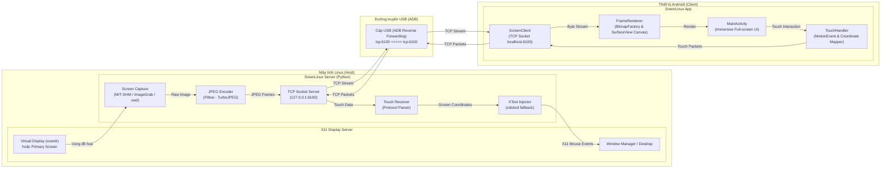
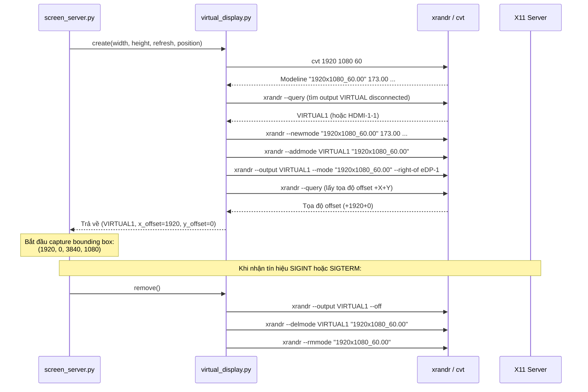

# Kiến Trúc Kỹ Thuật SreenLinux (Technical Architecture)

Tài liệu này mô tả chi tiết kiến trúc phần mềm, giao thức truyền thông nhị phân, cơ chế tạo màn hình ảo (Virtual Display) trên Linux X11, luồng xử lý sự kiện cảm ứng (Touch Input), và các tối ưu hóa hiệu năng của hệ thống **SreenLinux**.

---

## 1. Tổng Quan Kiến Trúc (System Overview)

SreenLinux gồm hai thành phần chính:
1. **Linux Server (`server/`)**: Chạy dưới dạng tiến trình nền bằng Python 3 trên máy tính Linux. Đảm nhiệm việc chụp màn hình (X11 Screen Capture), mã hóa JPEG, stream frame qua TCP socket và chuyển đổi sự kiện cảm ứng nhận được thành chuột/con trỏ X11 qua `xdotool`.
2. **Android Client (`android/`)**: Ứng dụng Android native (Java) hiển thị video stream thời gian thực trên `SurfaceView` với chế độ toàn màn hình (Immersive Mode), đồng thời ghi nhận sự kiện chạm (Touch Events) và gửi ngược về Linux.

Kết nối vật lý được thực hiện thông qua cáp USB và cơ chế chuyển tiếp cổng **ADB Reverse Port Forwarding** (`adb reverse tcp:6100 tcp:6100`), cho phép thiết bị Android kết nối trực tiếp đến `localhost:6100` với băng thông cao và độ trễ cực thấp.

### Sơ Đồ Hệ Thống (System Diagram)



---

## 2. Giao Thức Truyền Thông Nhị Phân (Binary Protocol Specification)

Giao thức truyền dữ liệu giữa Server và Client là giao thức nhị phân tối giản chạy trên nền TCP (cổng mặc định: `6100`), tất cả số nguyên đa byte đều sử dụng thứ tự **Big-Endian (Network Byte Order)** để đảm bảo tính độc lập nền tảng.

### 2.1. Chiều Server → Client: Luồng Khung Hình (Video Frame Stream)

Mỗi khung hình gửi từ Server sang Client gồm 2 phần: Header 4 bytes xác định độ dài và Payload là dữ liệu ảnh JPEG nén.

```
+-----------------------------------+-----------------------------------+
|     Độ dài ảnh (Frame Size)       |           Dữ liệu ảnh             |
|         4 Bytes (uint32)          |            (JPEG Data)            |
|            Big-Endian             |            N Bytes                |
+-----------------------------------+-----------------------------------+
```

- **Frame Size (4 bytes)**: Số byte chính xác của payload JPEG liền sau.
- **JPEG Data (N bytes)**: Dữ liệu ảnh JPEG hoàn chỉnh (bắt đầu bằng marker `0xFF 0xD8` và kết thúc bằng `0xFF 0xD9`).

#### Cơ chế xử lý tại Client:
1. Đọc đúng 4 bytes từ TCP socket để lấy `frame_size`.
2. Đọc tuần tự `frame_size` bytes vào buffer bộ nhớ đã được cấp phát trước.
3. Giải mã nhị phân thành Android `Bitmap` thông qua `BitmapFactory.decodeByteArray()`.
4. Render trực tiếp lên `SurfaceView` bằng Canvas được khóa (`lockCanvas() / unlockCanvasAndPost()`).

---

### 2.2. Chiều Client → Server: Sự Kiện Nhập Liệu (Input Events)

Mọi gói tin từ Client có kích thước cố định **6 bytes**, nhờ vậy Server có thể bỏ qua an toàn các loại gói tin chưa biết (tương thích về sau):

```
+---------------+---------------+-----------------------+-----------------------+
|  Packet Type  |     Arg       |      Tọa độ X         |       Tọa độ Y        |
|    1 Byte     |    1 Byte     |    2 Bytes (uint16)   |    2 Bytes (uint16)   |
+---------------+---------------+-----------------------+-----------------------+
```

| Type | Tên | Ý nghĩa của `Arg` | Hành động X11 |
|---|---|---|---|
| `1` | **TOUCH** | `0` DOWN · `1` MOVE · `2` UP | Kéo thả bằng chuột trái: nhấn / di chuyển / thả |
| `2` | **CLICK** | Nút chuột: `1` trái · `2` giữa · `3` phải | Di chuyển tới (X, Y) rồi click |
| `3` | **SCROLL** | `0` lên · `1` xuống · `2` trái · `3` phải | Một nấc cuộn (nút X11 4/5/6/7) tại (X, Y) |
| `4` | **KEY** | `0` nhấn · `1` nhả · `2` nhấn+nhả | 4 byte X/Y chứa **keysym X11** (32-bit). Ký tự Unicode `c` → `0x01000000 + c` (Latin-1 giữ nguyên) |

Tọa độ X/Y (type 1–3) luôn tính theo **pixel của khung hình** mà Client nhận được.

**Phím (type 4)**: Server tra keysym trong bảng phím hiện tại (`XGetKeyboardMapping`); nếu keysym nằm ở mức Shift thì tự nhấn Shift. Keysym không có trong layout (ví dụ `ệ`, `€`) được gán tạm vào một keycode trống (`XChangeKeyboardMapping`, giống `xdotool`) rồi phát qua `XTestFakeKeyEvent`. Trang web đọc bàn phím ảo qua một `<textarea>` ẩn và so sánh nội dung trước/sau mỗi lần nhập, nên tự sửa chính tả hay bộ gõ đều thành chuỗi Backspace + văn bản mới.

#### Nhận Diện Cử Chỉ (Android `TouchHandler`)

| Cử chỉ | Gói tin gửi đi |
|---|---|
| Chạm 1 ngón (không di chuyển quá *touch slop*) | `CLICK 1` |
| Giữ 1 ngón ≥ thời gian long-press | `CLICK 3` |
| Rê 1 ngón vượt *touch slop* | `TOUCH DOWN` tại điểm đặt ngón → `TOUCH MOVE`… → `TOUCH UP` |
| Rê 2 ngón | `SCROLL` mỗi ~12dp di chuyển của trọng tâm hai ngón (cuộn tự nhiên) |
| Chạm nhanh 2 ngón | `CLICK 3` |
| Chạm nhanh 3 ngón | Không gửi — bật/tắt overlay trên Android |

Thao tác nhấn chuột chỉ được gửi khi cử chỉ đã được xác định, nên một cú chạm không bao giờ vô tình kéo thả.

#### Chuyển Đổi Tọa Độ (Coordinate Mapping):
- **Phía Android**: Ảnh được vẽ giữ nguyên tỉ lệ (letterbox/pillarbox). `FrameRenderer.Mapping` là ảnh chụp bất biến của `(offsetX, offsetY, scale, frameW, frameH)`, dùng để đổi tọa độ chạm về tọa độ frame: `frame_x = clamp(round((view_x − offsetX) / scale))`.
- **Phía Linux**: `ClientHandler` chuyển tọa độ frame thành tọa độ màn hình X11 (khi dùng `--width/--height`, frame nhỏ hơn vùng chụp):
  $$\text{target\_x} = x_{\text{offset}} + \left\lfloor \text{client\_x} \times \frac{\text{capture\_w}}{\text{frame\_w}} \right\rfloor$$
  $$\text{target\_y} = y_{\text{offset}} + \left\lfloor \text{client\_y} \times \frac{\text{capture\_h}}{\text{frame\_h}} \right\rfloor$$
- Sự kiện được phát qua extension **XTest** (`XTestFakeMotionEvent` / `XTestFakeButtonEvent`, gọi trực tiếp bằng `ctypes`, không tạo tiến trình con). Nếu không có XTest, server dùng `xdotool` với các bước nối trong **một** lệnh (`xdotool mousemove X Y mousedown 1`) để đảm bảo đúng thứ tự.

### 2.3. Client Trình Duyệt (Web) Trên Cùng Cổng

`transport.classify()` đọc thử vài byte đầu của mỗi kết nối để phân loại:

| Byte đầu tiên | Loại client | Xử lý |
|---|---|---|
| `SRLN` + 2 byte phiên bản | **App Android** | Giao thức nhị phân ở trên |
| `GET /ws` (WebSocket upgrade) | **Trình duyệt** | Mỗi frame JPEG = 1 message nhị phân; input = message nhị phân chứa các gói 6 byte giống hệt app |
| `GET /`, `/manifest.json`, `/icon.png` | Trình duyệt | Trả file tĩnh trong `server/web/` |
| Im lặng quá 10 s | Kết nối dự phòng của trình duyệt (preconnect) | Đóng, **không** thay thế phiên đang chạy |
| Khác (POST, dữ liệu rác…) | — | Từ chối |

Bảo mật (vì WebSocket không bị CORS chặn, một trang web độc hại mở trên máy tính có thể thử kết nối `ws://localhost:6100`):
- Header `Host` phải là `localhost`/`127.0.0.1`/`[::1]` (chống DNS rebinding); khi chạy `--host 0.0.0.0` thì chấp nhận thêm địa chỉ IP, không chấp nhận tên miền.
- Header `Origin` của WebSocket phải trùng `http://<Host>`.
- Kết nối nhị phân bắt buộc bắt đầu bằng `SRLN`, nên request HTTP không thể giả mạo gói tin điều khiển chuột.

Trang web (`server/web/index.html`, không dùng thư viện ngoài) vẽ frame lên `<canvas>` bằng `createImageBitmap`, chỉ giải mã frame mới nhất (bỏ frame cũ nếu giải mã chậm), dùng Fullscreen API và Screen Wake Lock (`localhost` được coi là secure context).

### 2.4. Vòng Đời Kết Nối

- Server chấp nhận một client tại một thời điểm; **client mới sẽ thay thế client cũ** (hữu ích khi cáp USB bị rút và cắm lại nhưng kết nối cũ chưa kịp hết hạn).
- Khi màn hình không thay đổi, Server không gửi frame mới nhưng vẫn gửi lại frame cuối **mỗi 1 giây** làm keep-alive. Client coi kết nối đã chết nếu 10 giây không nhận được dữ liệu.
- App gửi gói chào `SRLN\x00\x01` ngay sau khi kết nối.
- Với `adb reverse`, lệnh `connect()` tới `localhost` luôn thành công (adbd nhận kết nối) kể cả khi server chưa chạy, vì vậy Client chỉ coi là **đã kết nối khi nhận được frame đầu tiên**.
- Client tự kết nối lại với exponential backoff 0.5s → 8s. Mạng chỉ được truy cập trên luồng nền: luồng nhận frame và luồng gửi sự kiện (hàng đợi `LinkedBlockingQueue`).

---

## 3. Cơ Chế Màn Hình Ảo (Virtual Display Mechanism)

SreenLinux hỗ trợ 2 chế độ hiển thị:
1. **Mirroring (Nhân bản màn hình)**: Chụp lại toàn bộ hoặc một vùng của màn hình vật lý hiện có trên Linux.
2. **Extended Display (Mở rộng màn hình)**: Tự động khởi tạo một màn hình phụ độc lập thông qua tiện ích `xrandr` của X11, biến Android thành màn hình mở rộng thứ hai (bên phải, bên trái, trên, hoặc dưới màn hình chính).

### Quy Trình Tạo Màn Hình Ảo (Lifecycle)



---

## 4. Pipeline Xử Lý Khung Hình (Frame Processing Pipeline)

Để duy trì tốc độ **30 khung hình/giây (FPS)** với độ trễ thấp (< 50ms) trên kết nối cáp USB:

1. **Capture Engine** (`ScreenCapture`, thử lần lượt):
   - **MIT-SHM** (`x11_native.ShmGrabber`): `XShmGetImage` qua `ctypes` vào vùng nhớ chia sẻ — ~8ms cho 1080p, không cần thư viện Python ngoài Pillow.
   - `PIL.ImageGrab.grab(bbox=...)` (XCB) — ~15ms.
   - `xwd -root -silent` + bộ giải mã XWD tự viết (Pillow không đọc được XWD) — chậm nhất, chỉ dùng khi hai cách trên lỗi.
   - Con trỏ chuột được lấy bằng **XFixes** (`XFixesGetCursorImage`) và ghép vào frame, vì ảnh chụp X11 không chứa con trỏ.
   - Với backend SHM, Server so sánh buffer pixel thô + vị trí con trỏ với frame trước để **bỏ qua frame không đổi**.
2. **Compressor**:
   - Nén ảnh sang định dạng JPEG với chất lượng điều chỉnh được (mặc định: `quality=50`), cân bằng tối ưu giữa độ sắc nét văn bản và kích thước truyền tải (~40KB - 90KB/frame ở độ phân giải 1080p).
   - Hỗ trợ resize tỉ lệ động nếu người dùng chỉ định `--width` hoặc `--height`.
3. **Throttling & Frame Dropping**:
   - Vòng lặp stream kiểm soát thời gian delta: $\Delta t = \frac{1}{\text{target\_fps}} \approx 33.3\text{ms}$.
   - Nếu thời gian capture + nén vượt quá thời gian của 1 frame, Server tự động bỏ qua (drop frame) để tránh dồn đống (pipeline buffer bloat), bảo đảm dữ liệu trên Android luôn là thời gian thực.
4. **Android Rendering**:
   - Android client sử dụng `SurfaceView` chạy trên render thread riêng biệt, không block UI thread.
   - Sử dụng `BitmapFactory.Options.inBitmap` và tái sử dụng bộ đệm (byte buffer reuse) để triệt tiêu hiện tượng GC pause (Garbage Collection giật lag).

---

## 5. Kiến Trúc Mô-đun Mã Nguồn (Codebase Structure)

```
Sreen_linux/
├── server/                     # Linux Host Server (Python 3)
│   ├── screen_server.py        # Điểm khởi chạy chính: TCP server, capture loop, input injection
│   ├── sreenlinux_service.py   # Dịch vụ hệ thống: theo dõi phiên X đang hoạt động (đăng nhập/desktop), chạy server bằng user tương ứng
│   ├── install-service.sh      # Cài dịch vụ systemd vào /opt/sreenlinux
│   ├── setup-headless.sh       # Màn hình ảo cho Jetson không cắm màn hình (xorg.conf + EDID)
│   ├── edid_gen.py             # Sinh EDID 128 byte cho màn hình ảo
│   ├── adb_watch.py            # Theo dõi USB: tự chạy adb reverse / mở client khi cắm điện thoại
│   ├── transport.py            # Phân loại kết nối: app (nhị phân) / trình duyệt (HTTP + WebSocket)
│   ├── web/                    # Client web: index.html, manifest.json, icon.png
│   ├── x11_native.py           # ctypes: MIT-SHM capture, XTest chuột/bàn phím, XFixes cursor
│   ├── virtual_display.py      # Quản lý vòng đời xrandr virtual monitor
│   ├── requirements.txt        # Thư viện phụ thuộc Python (Pillow)
│   ├── setup.sh                # Cài đặt công cụ hệ thống (xdotool, adb, x11-utils)
│   ├── start.sh                # Script tiện ích kiểm tra môi trường và khởi động server
│   └── install-autostart.sh    # Tự khởi động server khi đăng nhập (XDG autostart)
├── android/                    # Android Native Client (Java / Gradle)
│   ├── app/src/main/
│   │   ├── java/com/sreenlinux/display/
│   │   │   ├── MainActivity.java    # Quản lý vòng đời UI, immersive mode, overlay 3 ngón
│   │   │   ├── ScreenClient.java    # Phiên TCP: luồng nhận frame, luồng gửi sự kiện, auto-reconnect
│   │   │   ├── FrameRenderer.java   # Giải mã JPEG và render lên SurfaceView, mapping tọa độ
│   │   │   └── TouchHandler.java    # Nhận diện cử chỉ (tap, long-press, drag, scroll 2 ngón)
│   │   ├── res/                     # Layout, strings, colors, styles
│   │   └── AndroidManifest.xml      # Cấu hình quyền INTERNET và thuộc tính hiển thị
│   ├── gradlew, gradle/wrapper/     # Gradle wrapper 7.5.1
│   ├── build.gradle                 # Cấu hình Gradle cấp project
│   ├── settings.gradle
│   └── gradle.properties
├── docs/                       # Tài liệu kỹ thuật
│   ├── ARCHITECTURE.md         # Tài liệu kiến trúc (tài liệu này)
│   └── TROUBLESHOOTING.md      # Cẩm nang xử lý sự cố thường gặp
├── LICENSE                     # Giấy phép mã nguồn mở MIT
├── README.md                   # Tài liệu hướng dẫn sử dụng tổng thể (VI & EN)
└── .gitignore                  # Cấu hình loại trừ file rác Git
```
